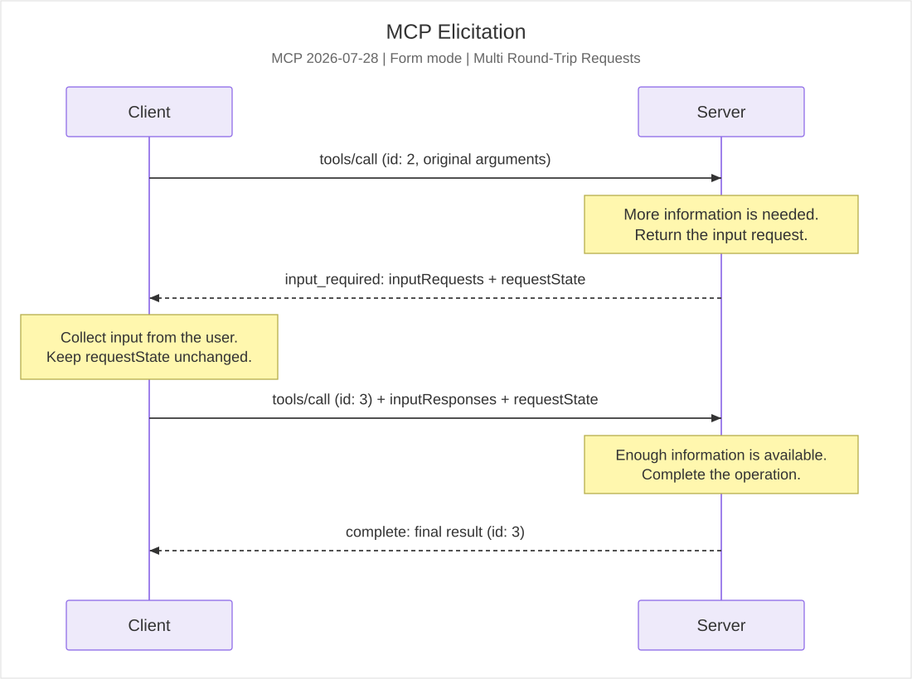
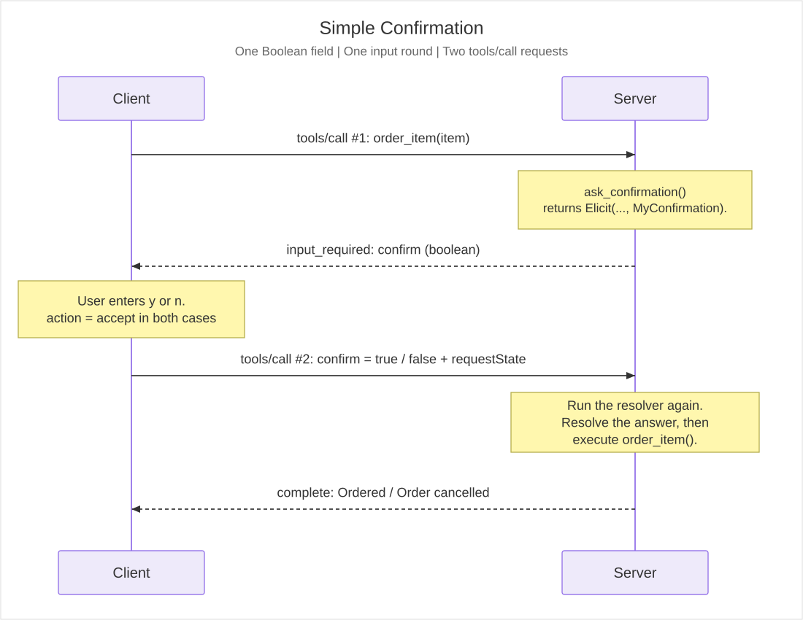
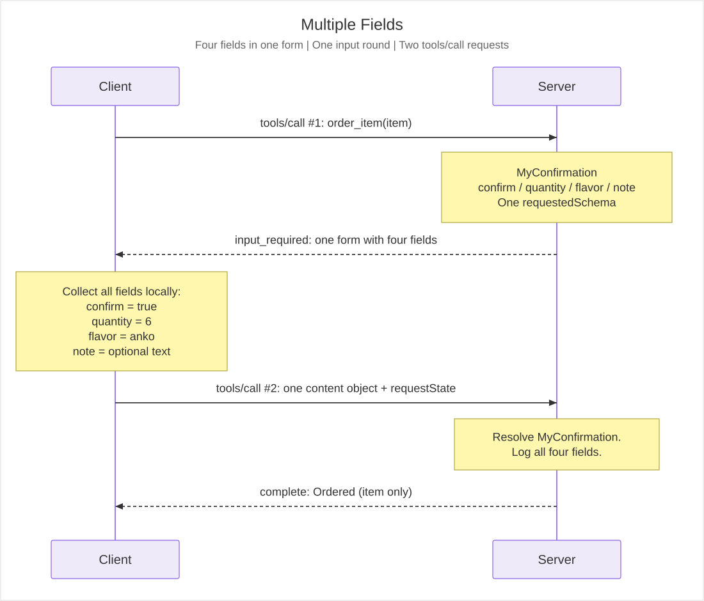
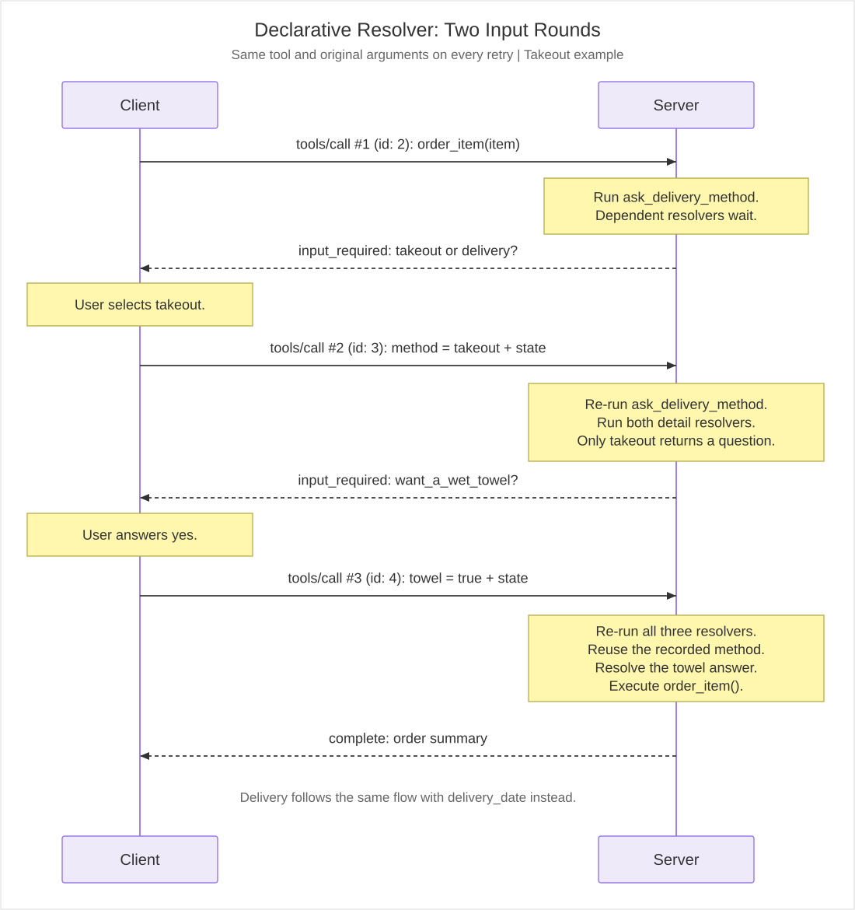
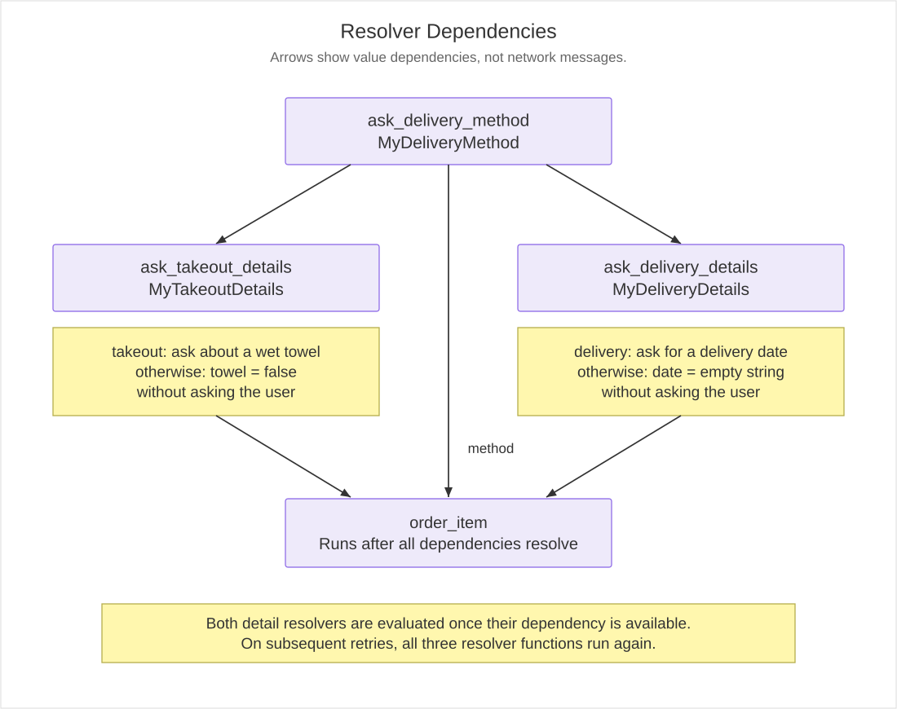
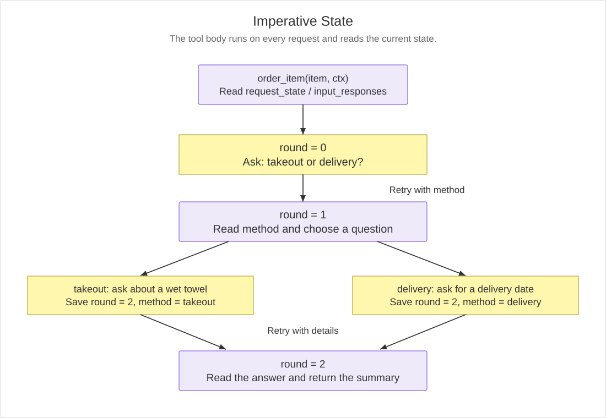

#### 最終更新日: October 12, 2026

# MCP Elicitation

本ディレクトリーは、AI エージェントが処理の途中で人間に確認や追加情報を求める仕組みである、Model Context Protocol (MCP) の **Elicitation** を動作させてみた結果を個人的に記録したものです。「おだんごの注文」を題材に、単純な確認、複数項目の入力、回答に応じた追加質問を順に試しました。

今回は **MCP 仕様 2026-07-28**、**MCP SDK for Python v2.3.0** を使用しています。検証対象は **Form Mode** で、サーバーとクライアント間の通信には **Streamable HTTP** を使用しています。

## 00. MCP Elicitation 概要

### 00-1. Elicitation とは

[Elicitation](https://modelcontextprotocol.io/specification/2026-07-28/client/elicitation) は、MCP サーバーが処理に必要な情報を、MCP クライアントを介してユーザーに問い合わせるための仕組みです。例えば、注文を確定する前の確認や、受け取り方法・希望日の入力などに利用できます。

入力を求める方法には、主に次の2種類があります。

| Mode | 概要 | 今回の検証 |
| --- | --- | --- |
| Form Mode | サーバーがメッセージと JSON Schema を返し、クライアントが入力を受け付ける | 対象 |
| URL Mode | ユーザーを外部 URL へ案内し、認証や支払いなどを外部で行う | 対象外 |

Form Mode が定めるのは入力項目の構造です。画面のデザインや入力方法はクライアント側の実装に委ねられており、今回は Python の `input()` を使ったコンソール入力で確認しています。また、今回のコードでは LLM を呼び出していません。MCP クライアントとサーバーだけで、人間からの入力を受け取る流れを観察しています。

Elicitation は MCP 本体の仕様に含まれる機能です。一方、MCP Apps などの Extensions は、コアの仕組みの上に機能を追加するものです。この位置付けについては、[Understanding MCP Extensions](https://blog.modelcontextprotocol.io/posts/2026-03-11-understanding-mcp-extensions/) および [Extensions Overview](https://modelcontextprotocol.io/extensions/overview) をご参照ください。

### 00-2. MCP 2026-07-28 における処理の流れ

MCP 仕様 2026-07-28 では、サーバーから独立したリクエストを送る従来の方式に代わり、[Multi Round-Trip Requests (MRTR)](https://modelcontextprotocol.io/specification/2026-07-28/basic/patterns/mrtr) を使用します。



1. クライアントが Tool を呼び出します。
2. サーバーは追加情報が必要な場合、`resultType: "input_required"` とともに質問を返します。
3. クライアントがユーザーから回答を受け取り、元の Tool 名・引数に回答と状態を添えて再試行します。
4. サーバーは必要な情報がそろうと処理を完了し、`resultType: "complete"` を返します。

ここで使用される主なフィールドは次の通りです。

| フィールド | 役割 |
| --- | --- |
| `inputRequests` | サーバーが返す追加入力の要求。今回の要求の `method` は `elicitation/create` |
| `requestedSchema` | Form Mode で入力してもらう項目の JSON Schema |
| `inputResponses` | クライアントが再試行時に返す回答。`inputRequests` と同じキーで対応付ける |
| `requestState` | 次の試行に引き継ぐ状態。クライアントは内容を解釈・変更せず、そのまま返す |

図の破線はサーバーからの**応答**を表します。`elicitation/create` はこの応答の `inputRequests` に含まれており、独立したサーバー起点の JSON-RPC リクエストではありません。また、再試行は別のリクエストになるため、JSON-RPC の `id` も変わります。

今回のクライアントでは `elicitation_callback` を登録し、`client.call_tool()` を1回呼び出しています。その内部で SDK が追加入力の要求を受け取り、コールバックの呼び出しと再試行を行います。したがって、アプリケーションコード上の呼び出し回数と、ログに記録される `tools/call` の回数は異なります。

### 00-3. 検証環境とサンプルの構成

| 項目 | 使用した内容 |
| --- | --- |
| MCP 仕様 | `2026-07-28` |
| MCP SDK for Python | `v2.3.0` |
| Server | `mcp.server.mcpserver.MCPServer` |
| Client | `mcp.Client`、`mode="auto"` |
| Transport / URL | Streamable HTTP / `http://127.0.0.1:8000/mcp` |
| 入力方法 | Form Mode / コンソール入力 |

`mode="auto"` はプロトコルバージョンを固定する指定ではありません。今回の接続ではログに `2026-07-28` が記録されています。モードの違いは [Protocol versions](https://github.com/modelcontextprotocol/python-sdk/blob/main/docs/protocol-versions.md)、v1 系と v2 系の変更点は [migration.md](https://github.com/modelcontextprotocol/python-sdk/blob/main/docs/migration.md) に解説があります。

| フォルダー | 確認した内容 | 入力ラウンド数 / `tools/call` 回数¹ | 実行結果 |
| --- | --- | --- | --- |
| [01-basic](01-basic/) | Boolean 1項目による注文確認 | 1 / 2 | [results.md](01-basic/results.md) |
| [02-multiple-fields](02-multiple-fields/) | 1つのフォームに複数項目をまとめる | 1 / 2 | [results.md](02-multiple-fields/results.md) |
| [03-multi-round-trip-declarative-resolver](03-multi-round-trip-declarative-resolver/) | Resolver の依存関係で段階的な質問を組み立てる | 2 / 3 | [results.md](03-multi-round-trip-declarative-resolver/results.md) |
| [04-multi-round-trip-imperative-state](04-multi-round-trip-imperative-state/) | Tool 自身が状態を読み、次の質問を決める | 2 / 3 | [results.md](04-multi-round-trip-imperative-state/results.md) |

¹ 掲載ログの各ケースについて、初回の Tool 呼び出しと再試行を数えたものです。接続時の通信などは含みません。「入力ラウンド」は1つの `input_required` 応答に対して回答を返す単位で、入力項目の数とは異なります。**01・02も MRTR を使用しており、03・04はそれを2段階の入力に広げた例です。**

各サンプルは、対象フォルダーで `python server.py` を実行し、別のターミナルで `python client.py` を実行する構成です。全サンプルが同じポートを使用するため、サーバーは1つずつ起動します。以下の実行結果は、公開済みの `results.md` に記録された内容を整理したものです。

## 01. Simple

### 01-1. 概要

[01-basic](01-basic/) は、「おだんごを注文してよいか」を確認する最も単純な例です。ユーザーから受け取るデータは、`MyConfirmation` に定義した `confirm: bool` の1項目です。



### 01-2. 実装のポイント

[server.py](01-basic/server.py) では、質問を作る `ask_confirmation()` と、注文を処理する `order_item()` を分けています。Tool の `confirmation` パラメーターには、次のように Resolver を指定しています。

```python
confirmation: Annotated[
    MyConfirmation,
    Resolve(ask_confirmation),
]
```

`Resolve(ask_confirmation)` は、`confirmation` の値を Tool 呼び出しの引数から直接受け取るのではなく、指定した関数で解決することを表します。Resolver が `Elicit(..., MyConfirmation)` を返すと、SDK が確認フォームを作成します。回答が解決された後に、`order_item()` の本体が実行されます。

[client.py](01-basic/client.py) は、コールバックで `y/n` を入力してもらい、`ElicitResult` を返します。Resolver による Elicitation の説明は、[SDK の Elicitation ドキュメント](https://github.com/modelcontextprotocol/python-sdk/blob/main/docs/handlers/elicitation.md) をご参照ください。

### 01-3. 実行結果

[results.md](01-basic/results.md) には、`y` と `n` の両方の実行結果を格納しています。

| 入力 | `action` | `content` | 最終結果 |
| --- | --- | --- | --- |
| `y` | `accept` | `{"confirm": true}` | `Ordered: おだんご` |
| `n` | `accept` | `{"confirm": false}` | `Order cancelled.` |

どちらも `tools/call` は2回で、最初の応答が `input_required`、次が `complete` です。ログでは Resolver が再試行時にも呼ばれ、Tool 本体は回答がそろった後に実行されていることが分かります。

ここでの `n` は、フォームに「注文しない」と回答したものです。**Elicitation の `action="decline"` とは異なり、`action="accept"` と `confirm=False` の組み合わせ**になります。仕様上の `accept`・`decline`・`cancel` は、フォームの送信・拒否・取り消しを表すものです。詳しくは [Response Actions](https://modelcontextprotocol.io/specification/2026-07-28/client/elicitation#response-actions) をご参照ください。

なお、このクライアントの Boolean 判定は `answer == "y"` です。`n` 以外でも、`y` でなければ `False` として扱います。

## 02. Multiple Fields

### 02-1. 概要

[02-multiple-fields](02-multiple-fields/) では、確認に加えて個数・味（flavor）・備考（note）を受け取ります。サーバー側の `MyConfirmation` を拡張し、1つの Form Mode の要求で複数の項目を尋ねています。



### 02-2. 入力項目とクライアントの処理

| フィールド | Python の型 | 必須 | 内容 |
| --- | --- | --- | --- |
| `confirm` | `bool` | 必須 | 注文を続けるか |
| `quantity` | `int` | 必須 | 注文する個数 |
| `flavor` | `Literal["mitarashi", "anko", "kinako"]` | 必須 | 味の選択 |
| `note` | `str \| None`、既定値 `None` | 任意 | 備考 |

[client.py](02-multiple-fields/client.py) は、受け取った `requested_schema` の `properties` と `required` を読み、フィールドごとに入力を受け付けます。Boolean は `y/n`、整数は数値入力、`enum` は番号による選択として表示しています。任意項目が空欄の場合は、回答の `content` にその項目を含めません。

コンソールでは4項目を順番に入力しますが、回答は1つの `ElicitResult` にまとめて返します。**項目が4つあっても、追加入力のラウンドは1回**です。フォームの構造については、[Form Mode Elicitation Requests](https://modelcontextprotocol.io/specification/2026-07-28/client/elicitation#form-mode-elicitation-requests) に記載されています。

### 02-3. 実行結果

[results.md](02-multiple-fields/results.md) の記録では、次の値を入力しています。

```json
{
  "confirm": true,
  "quantity": 6,
  "flavor": "anko",
  "note": "おまけしてくださいな"
}
```
サーバーログには4項目が表示され、最終結果は  `Ordered: おだんご` となっています。`quantity`・`flavor`・`note` はサーバー側で受け取って表示していますが、今回の [order_item()](02-multiple-fields/server.py) の戻り値には含めていません。

この例から、入力項目をサーバー側のスキーマとして定義し、それをクライアント側で解釈することで、複数種類の入力を共通の処理で受け付けられることが分かります。ただし、個数を正の値に限定するなどの業務上の条件は、このコードでは定義していません。

## 03. Multi Round-trip Declarative Resolver

### 03-1. 概要

[03-multi-round-trip-declarative-resolver](03-multi-round-trip-declarative-resolver/) では、最初に受け取り方法を尋ね、その回答によって次の質問を変えます。

| 1回目の回答 | 2回目の質問 | 回答の型 |
| --- | --- | --- |
| `takeout` | お手拭きを利用するか | `want_a_wet_towel: bool` |
| `delivery` | いつ届けるか | `delivery_date: str` |

前章は「決まった複数項目をまとめて尋ねる」例でした。この章では「前の回答を受け取ってから、次に尋ねる項目を決める」ため、入力が2段階になります。



### 03-2. Resolver の依存関係

[server.py](03-multi-round-trip-declarative-resolver/server.py) では、次の3つの Resolver を定義しています。

| Resolver | 役割 |
| --- | --- |
| `ask_delivery_method` | 受け取り方法を尋ねる |
| `ask_takeout_details` | 受け取り方法を参照し、`takeout` のときだけお手拭きの有無を尋ねる |
| `ask_delivery_details` | 受け取り方法を参照し、`delivery` のときだけお届け日を尋ねる |

後ろの2つは、引数に指定した `Resolve(ask_delivery_method)` によって、最初の回答に依存します。Tool 側も `Resolve(...)` を使って3つの値を受け取るように宣言しています。



この関係は、向きを持ち、循環しない依存関係である **DAG (Directed Acyclic Graph / 有向非巡回グラフ)** として表せます。図の矢印は値の依存関係を示しており、ネットワーク通信を表すものではありません。

ただし、このサンプルで注目したいのはグラフの形だけではありません。**どの値がどの Resolver に依存するかを宣言し、その解決を SDK に任せている**点です。そのため、フォルダー名を `declarative-resolver` としています。

このサンプルでは、**受け取り方法が解決された後は、`takeout`・`delivery` のどちらを選んでも、3つすべての Resolver が実行されます。** 選択によって変わるのは、Resolver を実行するかどうかではなく、質問を返すか、質問せずに値を返すかです。`takeout` の場合、`ask_delivery_details` は `MyDeliveryDetails(delivery_date="")` を返すため、お届け日の入力は要求されません。逆に `delivery` の場合、`ask_takeout_details` は `MyTakeoutDetails(want_a_wet_towel=False)` を返すため、お手拭きの有無は質問されません。

### 03-3. リクエストと状態の引き継ぎ

掲載ログの `tools/call` は、次の3回です。

| 試行 | クライアントが渡す内容 | サーバーの応答 |
| --- | --- | --- |
| 1回目 / `id: 2` | `item="おだんご"` | 受け取り方法を求める `input_required` |
| 2回目 / `id: 3` | 同じ引数、受け取り方法の回答、直前の `requestState` | 選択に応じた追加質問の `input_required` |
| 3回目 / `id: 4` | 同じ引数、追加質問の回答、直前の `requestState` | 注文内容を含む `complete` |

[results.md](03-multi-round-trip-declarative-resolver/results.md) の `takeout` の例では、最初に受け取り方法を選び、次にお手拭きを「利用する」と回答しています。各再試行で送る `inputResponses` の `content` は、次のように変わります。

| 再試行 | `inputResponses` に含まれる回答の `content` |
| --- | --- |
| 2回目の `tools/call` / `id: 3` | `{"method": "takeout"}` |
| 3回目の `tools/call` / `id: 4` | `{"want_a_wet_towel": true}` |

つまり、**最後の `inputResponses` に含まれるのは、2回目の質問への回答だけ**です。1回目の回答である `{"method": "takeout"}` を、ここに再び含めるわけではありません。それでも、同じ [results.md](03-multi-round-trip-declarative-resolver/results.md) の最終結果には、次のように両方の回答が反映されています。

```text
ご注文: おだんご
受け取り方法: takeout
おしぼりは必要か: True
```

前に答えた受け取り方法は、`inputResponses` に再送するのではなく、`requestState` として引き継がれた SDK の管理する状態から利用されます。ログ中には `outcomes`・`asked` などが見えますが、これはアプリケーション側のミドルウェアが表示した内部構造です。クライアントはその内容を解釈・変更せず、直前の応答で受け取った `requestState` をそのままサーバーへ返します。今回のクライアントでは、この状態の引き継ぎと再試行も SDK が自動で行います。

**Resolver を使った MRTR では、再試行のたびに依存関係をたどり直し、実行可能な Resolver の関数本体も再実行されます。回答済みの Resolver の実行自体が省略されるわけではありません。** 今回の例では、受け取り方法が解決できる2回目以降、3つすべての Resolver が毎回実行されています。

掲載ログで確認できる実行状況は次の通りです。`takeout`・`delivery` のどちらでも同じです。

| 関数 | 初回 / `id: 2` | 再試行 / `id: 3` | 再試行 / `id: 4` |
| --- | --- | --- | --- |
| `ask_delivery_method` | 実行 | 再実行 | 再実行 |
| `ask_takeout_details` | 未実行（依存する回答待ち） | 実行 | 再実行 |
| `ask_delivery_details` | 未実行（依存する回答待ち） | 実行 | 再実行 |
| `order_item` の本体 | 未実行 | 未実行 | 実行 |

初回は受け取り方法が未確定のため、後続2つの Resolver はまだ実行できません。したがって「毎回すべて」という点は、**依存する値がそろい、実行可能になった Resolver についての挙動**として読む必要があります。また、同一リクエスト内で複数の依存先が同じ Resolver を参照しても、そのリクエスト内では重複実行が抑えられます。再試行をまたいだ再実行とは別の話です。

SDK が引き継ぐのは質問に対する回答であり、Resolver の関数本体を実行しなくてよいという意味でのキャッシュではありません。Resolver を実行して質問が組み立てられた後、対応する回答がすでにあれば、それを使って値を解決します。そのため、**Resolver の再実行と、ユーザーへの再質問は別のもの**です。

この挙動を踏まえると、Resolver 内に時間のかかる処理や外部への書き込みを置く場合は、再試行によって処理が繰り返されることを考慮する必要があります。今回のように、Resolver では質問や値を組み立て、注文を確定する処理は必要な値がそろった後の Tool 本体に置く構成が理解しやすいと思います。ただし、入力項目が増えたり、Resolver の依存関係が複雑になったりすると、再評価の負荷に加え、分岐や依存関係を把握・保守する負担も大きくなるため、この構成をそのまま拡張していくのは現実的ではないと思います。その場合は、複数項目を1つのフォームにまとめる方法や、後述の Imperative State のように状態に応じて次の処理を明示的に決める構成も検討する必要があります。実装上の再評価とリクエスト内の重複抑制は、[SDK v2.3.0 の Resolver 実装](https://github.com/modelcontextprotocol/python-sdk/blob/v2.3.0/src/mcp/server/mcpserver/resolve.py) でも確認できます。

### 03-4. 1つの Resolver で複数の Elicit 型を返そうとした場合

受け取り方法に応じて質問を変えるのであれば、1つの `ask_order_details()` に分岐をまとめたくなります。しかし、MCP Python SDK v2.3.0 では、次のように**異なるモデルの `Elicit[...]` を戻り値の Union に複数並べることはできません**。以下はエラーになる書き方です。

```python
async def ask_order_details(
    delivery_method: Annotated[
        MyDeliveryMethod,
        Resolve(ask_delivery_method),
    ],
) -> Elicit[MyTakeoutDetails] | Elicit[MyDeliveryDetails] | Elicit[MyDeliveryMethod]:
    print("** Resolver `ask_order_details` was called.\n")

    if delivery_method.method == "takeout":
        return Elicit(
            "テイクアウトですね。もう少し教えてください。",
            MyTakeoutDetails,
        )
    elif delivery_method.method == "delivery":
        return Elicit(
            "お届けですね。もう少し教えてください。",
            MyDeliveryDetails,
        )
    else:
        return Elicit(
            "申し訳ございません。よく分かりませんでした。",
            MyDeliveryMethod,
        )
```

この Resolver を Tool の依存関係に組み込むと、戻り値の型注釈の検証で `InvalidSignature` になります。検証時に記録したエラーは次の通りです。

```text
mcp.server.mcpserver.exceptions.InvalidSignature: Resolver 'ask_order_details' return annotation has multiple Elicit/Sample/ListRoots arms; a resolver asks one question - split it into separate resolver
```

これは `if` による分岐そのものを禁止しているのではありません。SDK が1つの Resolver に対して扱う質問の定義を、型注釈から1つに定めるための制約です。実行時にはどれか1つしか返さないつもりでも、型注釈に `Elicit[MyTakeoutDetails]`・`Elicit[MyDeliveryDetails]`・`Elicit[MyDeliveryMethod]` が並んでいる時点で拒否されます。SDK v2.3.0 の [`_check_elicit_return()`](https://github.com/modelcontextprotocol/python-sdk/blob/v2.3.0/src/mcp/server/mcpserver/resolve.py#L285-L304) は、戻り値の候補に複数の `Elicit` / `Sample` / `ListRoots` がある場合に例外を送出します。

そのため、現在のコードでは質問ごとに Resolver を分けています。次のように、**1種類の `Elicit[T]` と、質問せずに返す通常の値 `T` を組み合わせる書き方は可能**です。

これは、どちらの経路でも最終的に同じ型 `T` の値を解決するためです。`Elicit[T]` を返す場合は「ユーザーに質問し、その回答から `T` を得る」、`T` を直接返す場合は「質問せず、その値で解決する」という違いがあります。例えば `Elicit[MyTakeoutDetails] | MyTakeoutDetails` では、質問する場合のスキーマは `MyTakeoutDetails` の1種類に定まります。

SDK の戻り値の検証が数えているのは、Union に含まれる型の総数ではなく、`Elicit` / `Sample` / `ListRoots` という**クライアントへの要求を表す型の候補数**です。通常の値 `T` は要求を表す型ではないため、この数に含まれません。したがって `Elicit[T] | T` の要求候補は1つですが、`Elicit[A] | Elicit[B]` は2つになり、前述の制約に抵触します。

実行時も、SDK は戻り値が `Elicit` なら質問と回答の処理を行い、通常の値ならそのまま解決済みの値として扱います。この「必要なら質問し、分かっていれば値を直接返す」という使い方は、[SDK の Elicitation ドキュメント](https://github.com/modelcontextprotocol/python-sdk/blob/v2.3.0/docs/handlers/elicitation.md#ask-with-a-resolver) でも説明されています。

```python
async def ask_takeout_details(
    delivery_method: Annotated[
        MyDeliveryMethod,
        Resolve(ask_delivery_method),
    ],
) -> Elicit[MyTakeoutDetails] | MyTakeoutDetails:
    if delivery_method.method == "takeout":
        return Elicit(
            "テイクアウトですね。もう少し教えてください。",
            MyTakeoutDetails,
        )
    return MyTakeoutDetails(want_a_wet_towel=False)
```
### 03-5. 実行結果

[results.md](03-multi-round-trip-declarative-resolver/results.md) には、`takeout` と `delivery` の両方の結果を格納しています。以下は最後に表示された注文内容の抜粋です。

**Takeout**

```text
ご注文: おだんご
受け取り方法: takeout
おしぼりは必要か: True
```

**Delivery**

```text
ご注文: おだんご
お受け取り方法: delivery
お届け日: 2026/10/11でお願いします。
```

お届け日は `str` で受け取っています。上の文字列は掲載ログの入力をそのまま示したもので、日時への変換や、未来の日付かどうかの検証は行っていません。

### 03-6. Imperative State との比較

比較用の [04-multi-round-trip-imperative-state](04-multi-round-trip-imperative-state/) でも、受け取り方法に応じて追加質問を行います。クライアント側のコードは03と同じですが、[サーバー側](04-multi-round-trip-imperative-state/server.py) は `Resolve` を使わず、Tool 自身が `ctx.request_state` と `ctx.input_responses` を読み、`InputRequiredResult` を返します。



| 比較項目 | Declarative Resolver / 03 | Imperative State / 04 |
| --- | --- | --- |
| 処理の組み立て方 | `Resolve` で値の依存関係を宣言する | Tool 内の `if` で次の処理を決める |
| 追加入力の要求 | Resolver が `Elicit` を返す | Tool が `InputRequiredResult` を返す |
| アプリケーションが管理する状態 | Resolver の解決状態は SDK に任せる | `round` と `method` を JSON にして `request_state` に設定する |
| Tool 本体の実行 | 必要な値がそろった後 | 初回から毎回実行し、状態に応じて分岐する |
| 再試行時の処理 | 実行可能な Resolver を毎回再評価する | Tool が状態を読み、該当する分岐を実行する |
| 掲載ログの `tools/call` 回数 | 3回 | 3回 |

04では、`round=0` で受け取り方法を質問し、`round=1` で回答に応じた追加質問を返し、`round=2` で最終結果を作ります。これはアプリケーションの進行状態を表す値で、JSON-RPC のリクエスト ID とは別のものです。

[04の results.md](04-multi-round-trip-imperative-state/results.md) では、テイクアウトでお手拭き `True`、お届けで希望日「明日ぐらいで。」を入力した結果が記録されています。どちらも入力2段階、`tools/call` 3回で完了しています。

03と04は、ユーザーに尋ねる内容と MRTR の通信パターンは共通です。違いは、サーバーの処理を依存関係として記述するか、状態に応じた手順として記述するかにあります。

## 04. 参考URL

今回参照したページは次の通りです。GitHub の `main` は更新されるため、本 README の対象バージョンは冒頭に記載した **v2.3.0** としてお読みください。

- [Elicitation - Model Context Protocol](https://modelcontextprotocol.io/specification/2026-07-28/client/elicitation)
- [Multi Round-Trip Requests - Model Context Protocol](https://modelcontextprotocol.io/specification/2026-07-28/basic/patterns/mrtr)
- [python-sdk/docs/handlers/elicitation.md at main · modelcontextprotocol/python-sdk · GitHub](https://github.com/modelcontextprotocol/python-sdk/blob/main/docs/handlers/elicitation.md)
- [python-sdk/docs/protocol-versions.md at main · modelcontextprotocol/python-sdk · GitHub](https://github.com/modelcontextprotocol/python-sdk/blob/main/docs/protocol-versions.md)
- [python-sdk/docs/migration.md at main · modelcontextprotocol/python-sdk · GitHub](https://github.com/modelcontextprotocol/python-sdk/blob/main/docs/migration.md)
- [Understanding MCP Extensions | Model Context Protocol Blog](https://blog.modelcontextprotocol.io/posts/2026-03-11-understanding-mcp-extensions/)
- [Extensions Overview - Model Context Protocol](https://modelcontextprotocol.io/extensions/overview)

