#### 最終更新日: 2026/10/17

# MCP Apps

## 00. Overview

### 00-1. MCP Apps 概要

[MCP Apps](https://apps.extensions.modelcontextprotocol.io/api/) は、MCP Server が提供する対話的な画面を、対応する Host の中に表示するための [MCP 拡張](https://modelcontextprotocol.io/extensions/overview)です。Tool が返すデータをテキストで読むだけでなく、グラフや表で確認したり、フォームやボタンを操作したりできるようになります。例えば、検索結果を一覧から選択する画面や、条件を入力して結果を更新する画面を、会話の流れの中で利用できます。

ここでいう **Host** は、MCP Client を管理し、ユーザーに画面を提供するアプリケーションです。**App** は、その Host 内に埋め込まれる UI を指します。MCP Server は Tool と、それに関連付けた HTML の **UI Resource** を提供します。Host は UI Resource を取得し、Sandbox 化した iframe 内に App を表示します。

UI Resource は `ui://` で始まる URI で識別され、Tool のメタデータに関連付けられます。Host はこの情報から表示する UI を判断します。Tool の実行結果と UI の HTML は別々に扱われ、Host が Tool の引数や結果を App に通知することで、画面にデータを反映できます。

通信は Host から App への通知だけではありません。ユーザーが App のボタンを押したりフォームを送信したりすると、App は Host を介して MCP Server の Tool を呼び出し、その結果を使って表示を更新できます。このように、MCP Apps は UI の配信と、Host・App 間の双方向通信を組み合わせて、Tool を画面から操作できるようにします。利用するには、Host 側も MCP Apps に対応している必要があります。

### 00-2. 検証環境

使用した SDK のバージョンは、次の通りです。

| 項目 | パッケージ | バージョン |
| --- | --- | --- |
| MCP SDK for Python | `mcp` | `2.3.0` |
| MCP Types for Python | `mcp-types` | `2.3.0` |
| MCP Apps SDK for JavaScript | `@modelcontextprotocol/ext-apps` | `2.0.3` |

Host と App の構成は、次の通りです。

| 項目 | 内容 |
| --- | --- |
| Host | FastAPI と HTML / JavaScript で実装した学習用の独自 Host（02〜06） |
| Host ↔ App の通信 | `AppBridge` / `App` と `PostMessageTransport` による JSON-RPC（03〜06） |
| UI の実行環境 | Sandbox 化した iframe（02〜06）。06では別オリジンの Sandbox Proxy と、その内側の iframe を使用 |

今回の検証では、MCP Server と MCP Client の通信に **In-memory Transport** を使用しています。両者を同じ Python プロセス内で動かし、メモリ上で MCP メッセージをやり取りします。ブラウザーと Host のバックエンド間では HTTP を使用しますが、この区間は MCP Server と Client 間の通信とは別です。

### 00-3. 検証内容

HTML の取得から始め、Host と App の通信、App からの Tool 呼び出し、入力フォーム、Sandbox による分離へと段階的に確認しました。

| フォルダー | 確認する内容 |
| --- | --- |
| [01-basic](01-basic/) | Tool と UI Resource の登録・取得 |
| [02-resource-rendering](02-resource-rendering/) | 取得した HTML を iframe に表示 |
| [03-host-app-communication](03-host-app-communication/) | Host から App へ Tool 引数・結果を通知 |
| [04-tool-calling-from-app](04-tool-calling-from-app/) | App のボタンから Tool を呼び出す |
| [05-interactive-ui](05-interactive-ui/) | 入力値を Tool に渡し、結果を画面に反映 |
| [06-security](06-security/) | 別オリジンの Sandbox Proxy と二重 iframe |

今回のコードでは LLM を呼び出さず、学習用に実装した Host で UI の表示と通信を確認しています。03〜06では JavaScript SDK の `App` / `AppBridge` を使用し、MCP Server との通信は Python 側で処理します。04〜06では、Host が App からの Tool 呼び出しを中継します。

以下のシーケンス図では、各章で確認する通信を中心に示し、MCP Client が接続時に行う `server/discover` を省略しています。今回使用する MCP Python SDK v2.3.0 の `Client` は、既定の `mode="auto"` で `server/discover` を行います。このサンプルの `MCPServer` との接続では、従来の `initialize` / `notifications/initialized` ハンドシェイクは使用しません。詳しくは [SDK の Protocol versions](https://github.com/modelcontextprotocol/python-sdk/blob/v2.3.0/docs/protocol-versions.md) をご参照ください。

一方、03〜06の図にある `ui/initialize` / `ui/notifications/initialized` は、MCP Apps の App と Host 間の初期化です。MCP Client と MCP Server 間の接続手順とは別のものであり、この検証でも使用しています。

## 01. Basic

[01-basic](01-basic/) は、UI と Tool を登録し、コンソールから取得する最も単純な例です。[server.py](01-basic/server.py) は `Apps` に `say_hello` と `ui://hello/app.html` を登録し、`MCPServer` の拡張として組み込みます。

### 01-1. Architecture

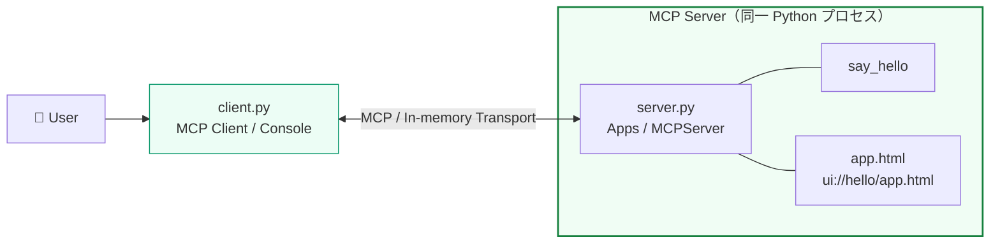

### 01-2. シーケンス図

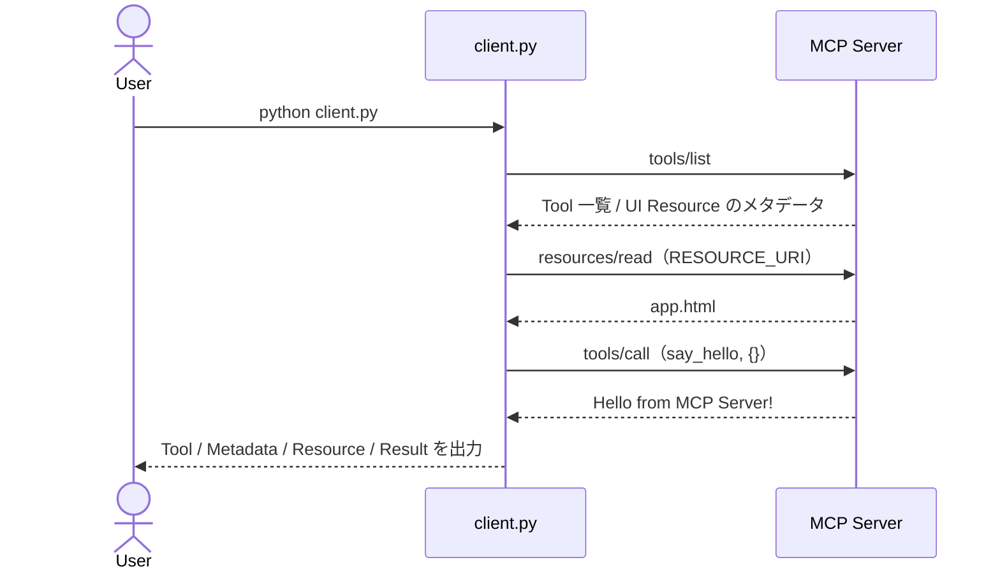

### 01-3. 実装のポイント

- [client.py](01-basic/client.py) は Apps Extension と対応 MIME type をサーバーに通知して接続します。
- `@apps.tool(resource_uri=...)` により Tool と UI Resource が関連付けられます。Tool のメタデータと HTML 本体は別々に取得します。
- この段階ではブラウザー表示や AppBridge はありません。HTML を取得しても、UI が自動的に表示されるわけではありません。
- このクライアントは `server.py` から読み込んだ `RESOURCE_URI` を使用します。02では Tool のメタデータから URI を取り出します。

### 01-4. 実行結果

実行結果は [console.txt](01-basic/console.txt) をご参照ください。

## 02. Resource Rendering

[02-resource-rendering](02-resource-rendering/) は、01で取得した HTML を Web Browser で表示する例です。[host.py](02-resource-rendering/host.py) が FastAPI と MCP Client の両方を担当します。

### 02-1. Architecture

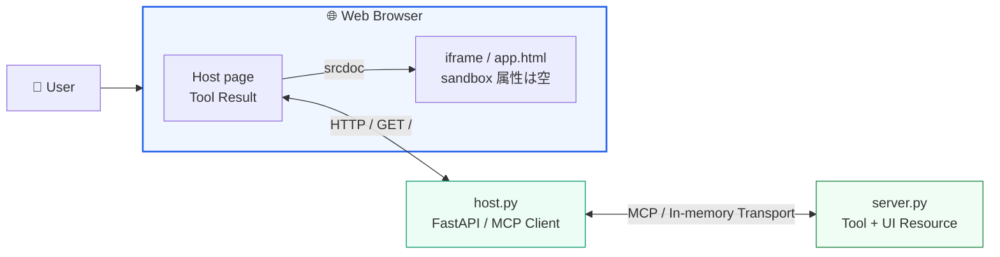

### 02-2. シーケンス図

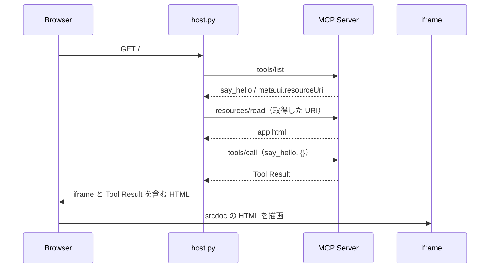

### 02-3. 実装のポイント

- `tool.meta["ui"]["resourceUri"]` から UI Resource の URI を取得します。
- 取得した HTML は `escape(..., quote=True)` で属性値としてエスケープし、`iframe.srcdoc` に埋め込みます。
- iframe 内の `Hello, MCP Apps!` と、Host 側の `Tool Result` は別の表示領域です。Tool 結果を App 内へ通知する処理はまだありません。
- `sandbox=""` の iframe で静的 HTML を表示します。この例では JavaScript を実行する権限を付けていません。

### 02-4. 実行結果

実行結果は [console.txt](02-resource-rendering/console.txt) をご参照ください。実行画面は次の通りです。

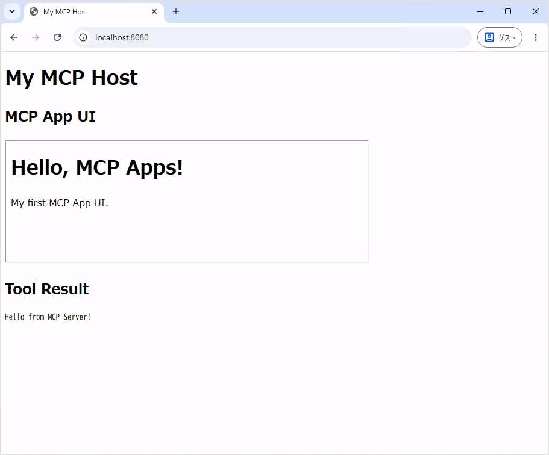

## 03. Host-App Communication

[03-host-app-communication](03-host-app-communication/) は、Host の `AppBridge` と iframe 内の `App` を接続し、Tool の引数・結果を通知する例です。[server.py](03-host-app-communication/server.py) は `app.bundle.js` を HTML に埋め込み、UI Resource として返します。

[AppBridge](https://apps.extensions.modelcontextprotocol.io/api/classes/app-bridge.AppBridge.html) は、MCP Apps SDK が提供する Host 側の通信窓口です。iframe 内の App との初期化や、Tool の引数・結果の通知を扱います。また、App からの Tool 呼び出し要求を受け取り、Host 側の処理へつなぐ役割も担います。

今回の03〜06では、`AppBridge` の第1引数に `null` を渡しています。MCP Client は Python のバックエンドに置き、JavaScript 側の `AppBridge` が App との通信を、Python 側の MCP Client が MCP Server との通信を担当します。04〜06では `oncalltool` を手動で登録し、App からの要求を HTTP 経由でバックエンドの `/call-tool` へ中継します。つまり、Host 全体として MCP Client を備えており、ブラウザー内に MCP Client を置く必要はありません。

JavaScript 側に接続済みの MCP Client がある構成では、それを `AppBridge` の第1引数に渡すことで、SDK の自動中継を利用できます。今回はフロントエンドとバックエンドで役割を分担するため、`null` と手動の中継処理を組み合わせています。詳しくは [AppBridge API Reference](https://apps.extensions.modelcontextprotocol.io/api/classes/app-bridge.AppBridge.html) をご参照ください。

### 03-1. Architecture

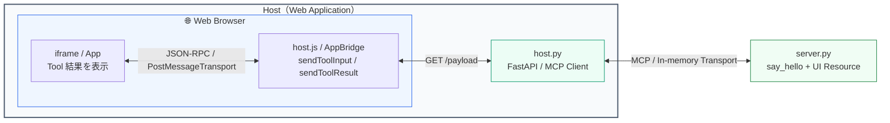

### 03-2. シーケンス図

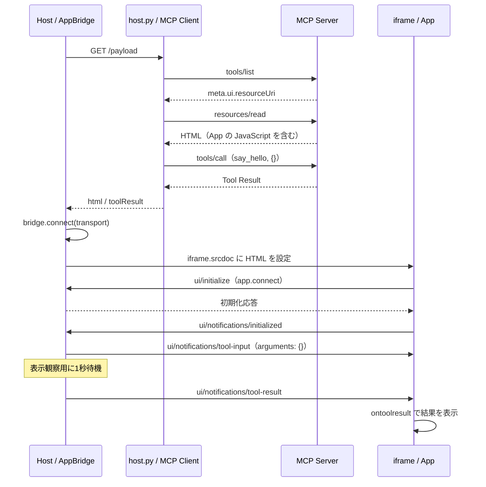

### 03-3. 実装のポイント

- [host.html](03-host-app-communication/host.html) の iframe は `sandbox="allow-scripts"` です。App の JavaScript を動かし、`PostMessageTransport` を介して JSON-RPC メッセージをやり取りします。
- Host は `/payload` で UI の HTML と Tool の実行結果を取得します。App の初期化が完了すると、`sendToolInput()` で引数を通知し、1秒待ってから `sendToolResult()` で結果を通知します。
- [app.js](03-host-app-communication/app.js) の `ontoolinput` はログを出力し、`ontoolresult` は `content` からテキストを取り出して表示します。
- ブラウザーの開発者ツールで `[JSON-RPC Host -> App]` / `[JSON-RPC App -> Host]` のログを確認できます。通知にはリクエストへの応答とは異なり、応答を対応付ける `id` がありません。

### 03-4. 実行結果

実行結果は下記の動画をご参照ください。

https://github.com/user-attachments/assets/0ad41e1a-15d6-4563-8855-3376e9032ae7

## 04. Tool Calling from App

[04-tool-calling-from-app](04-tool-calling-from-app/) は、App の「Say Hello」ボタンを押すと、MCP Server の `say_hello` Tool を呼び出し、その結果を App 内に表示する例です。03では Host から App へ Tool の引数・結果を通知しましたが、この章ではユーザーの操作をきっかけに、App から Host へ Tool の呼び出しを要求します。

App は `callServerTool()` に Tool 名と空の引数 `{}` を渡します。要求を受けた Host の `AppBridge` は、`oncalltool` に登録した処理を通じてバックエンドの `/call-tool` へ転送します。Python 側の MCP Client が Tool を実行すると、結果が同じ経路で App に返され、`Hello from MCP Server!` が表示されます。この流れを通じて、App が Host を介して MCP Server の機能を利用する仕組みを確認します。

### 04-1. Architecture

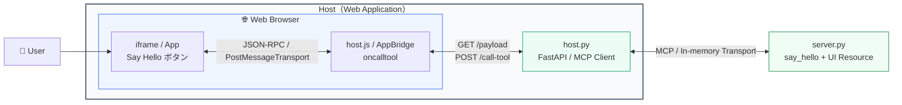

### 04-2. シーケンス図

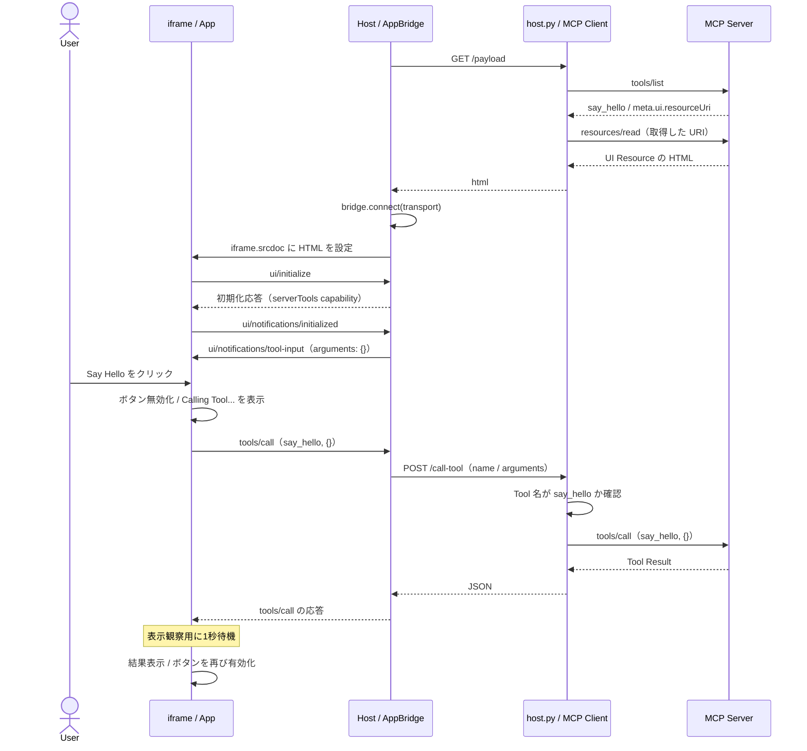

### 04-3. 実装のポイント

- [app.js](04-tool-calling-from-app/app.js) の `app.callServerTool()` が呼び出し元です。App から MCP Server へ直接 HTTP リクエストを送る構成ではありません。
- [host.js](04-tool-calling-from-app/host.js) は、`new AppBridge(...)` でインスタンスを作成するときに、第3引数の Host の機能情報として `{ serverTools: {} }` を指定します。これにより、Host がサーバーの Tool 呼び出しに対応していることを App に伝えます。App から呼び出し要求を受けると、`bridge.oncalltool` に登録した処理が、バックエンドの `/call-tool` に要求を転送します。
- [host.py](04-tool-calling-from-app/host.py) は `say_hello` 以外を HTTP 403 で拒否します。許可した Tool について新しい In-memory Client 接続を開き、結果を JSON で返します。
- 初期表示時の `/payload` は UI の HTML だけを返し、Tool は実行しません。Tool は「Say Hello」ボタンを押したときに実行し、App は `callServerTool()` の戻り値を使って結果を表示します。03で使用していた初回の Tool 呼び出しと `toolResult` の受け渡しは削除してあります。
### 04-4. 実行結果

実行結果は [ブラウザーのコンソールログ](04-tool-calling-from-app/browser-developer-tools-console.log.txt) と下記の動画をご参照ください。

https://github.com/user-attachments/assets/7b72f061-eb27-4282-9c88-10097255ff1e

## 05. Interactive UI

[05-interactive-ui](05-interactive-ui/) は、04の画面に名前の入力欄を追加し、入力内容に応じた挨拶を表示する例です。ユーザーが名前を入力して「Say Hello」ボタンを押すと、App は `callServerTool()` の `arguments` に `{ name: 入力した名前 }` を設定し、Host を介して `say_hello` Tool を呼び出します。例えば `Kazuma` と入力すると、MCP Server が返した `Hello Kazuma!` を App 内に表示します。

Tool 呼び出しの経路は04と同じですが、この章では入力値の確認や、処理中・完了・エラーに応じた画面の更新も行います。入力値の前後の空白を除き、空文字であれば呼び出しを行いません。呼び出し中はボタンを無効にして `Calling Tool...` を表示し、結果を受け取ると表示を更新して再び操作できるようにします。この流れを通じて、ユーザーの入力、Tool の実行、結果の表示を組み合わせた対話的な UI を確認します。

### 05-1. Architecture

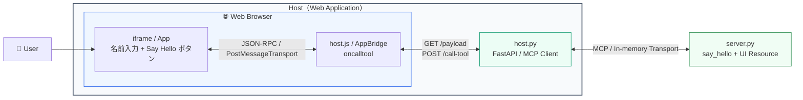

### 05-2. シーケンス図

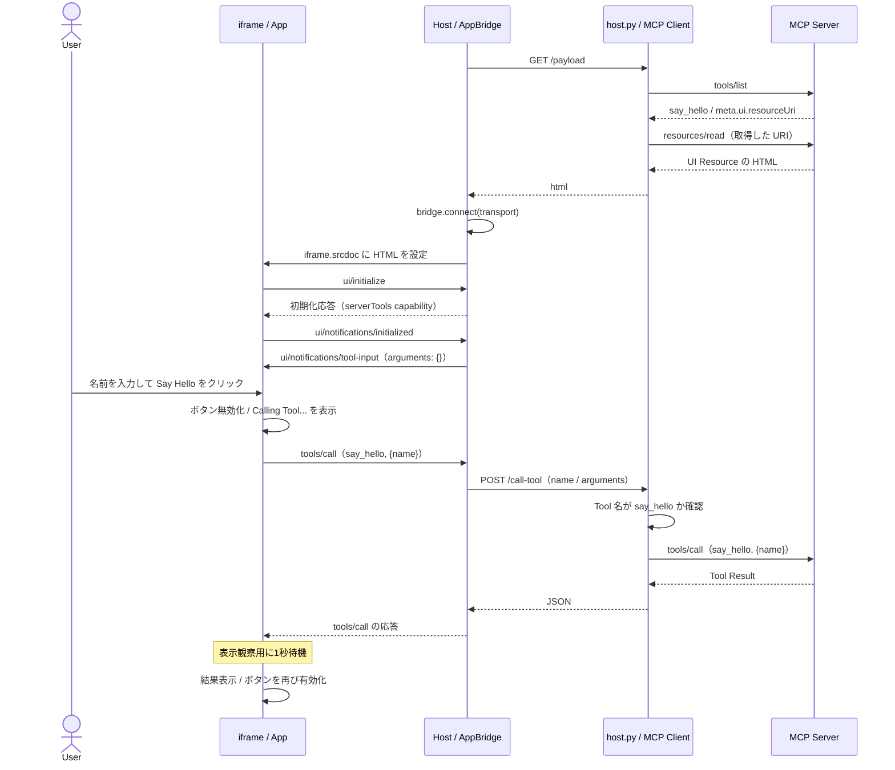

### 05-3. 実装のポイント

- [app.js](05-interactive-ui/app.js) は入力値を `trim()` し、空文字であれば Tool を呼び出さずに戻ります。
- [server.py](05-interactive-ui/server.py) の `say_hello(name: str = "")` は、名前があれば `Hello {name}!`、なければ従来の `Hello from MCP Server!` を返します。
- 呼び出し中はボタンを無効にし、`Calling Tool...` を表示します。`result.isError` または例外を検出すると `Tool call failed` を表示し、最後にボタンを再び有効にします。
- 1秒の待機は Tool 応答を受け取った後の表示観察用です。サーバーの処理時間を示すものではありません。
- 初期表示時の `/payload` は04と同様に UI の HTML だけを返し、Tool は実行しません。名前を入力してボタンを押すと Tool を呼び出し、その結果を画面に反映します。

### 05-4. 実行結果

実行結果は [ブラウザーのコンソールログ](05-interactive-ui/browser-developer-tools-console.log.txt) と下記の動画をご参照ください。

https://github.com/user-attachments/assets/ad110337-a1f7-4738-98bf-e17572287c50

## 06. Security

[06-security](06-security/) は、05の名前入力と Tool 呼び出しを維持しながら、App を Host の画面から分離し、必要な通信を中継する仕組みを確認する例です。MCP Server から取得した HTML / JavaScript を Host 内で動かすため、App が親画面の DOM を直接読み書きできる範囲と、メッセージでやり取りする範囲を明確にします。

この章では、Host（`http://localhost:8080`）と App の間に、別オリジンの **[Sandbox Proxy](https://github.com/modelcontextprotocol/ext-apps/blob/main/specification/2026-01-26/apps.mdx#sandbox-proxy)**（`http://localhost:8081`）を配置します。オリジンはスキーム・ホスト名・ポート番号の組み合わせで決まるため、この2つはポート番号の違いによって別オリジンになります。Host 内の外側の iframe に Proxy を表示し、Proxy が作る内側の iframe に App を読み込む二重構造です。内側の iframe には `sandbox="allow-scripts"` を指定し、App の JavaScript の実行を許可しつつ、親画面への DOM アクセスを制限します。

Sandbox Proxy は、Host と App の間で JSON-RPC メッセージを中継します。その際、送信元の Window とオリジンを確認し、App から Sandbox の制御用通知が送られた場合は中継しません。ユーザーが「Say Hello」ボタンを押すと、要求は App → Sandbox Proxy → Host → Python の MCP Client → MCP Server の順に渡り、結果は逆の経路で返されます。

App から親の DOM を参照する処理では `SecurityError` が発生しますが、メッセージを介した Tool 呼び出しは継続できます。この挙動を通じて、画面を分離しながら必要な機能を利用できることを確認します。また、App のサイズ変更通知を Proxy が受け取り、内側の iframe の高さに反映する処理も加えています。

[ブラウザーのコンソールログ](06-security/browser-developer-tools-console.log.txt#L62)には、次のエラーが記録されています。

> about:srcdoc:25815 [App] Parent DOM access blocked: SecurityError Failed to read a named property 'document' from 'Window': Blocked a frame with origin "null" from accessing a cross-origin frame.

これは、オリジンが `"null"` の App から、別オリジンの親画面（Sandbox Proxy）の `document` へのアクセスがブロックされたことを示しています。この検証では、App から意図的に親の DOM へのアクセスを試みているため、エラーの発生は想定した動作です。サンドボックスによる分離が機能し、App が親画面の DOM を直接参照できないことを確認できています。このエラーはコード内で捕捉してログに出力しており、その後もメッセージを介した Tool 呼び出しを続けられます。

### 06-1. Architecture

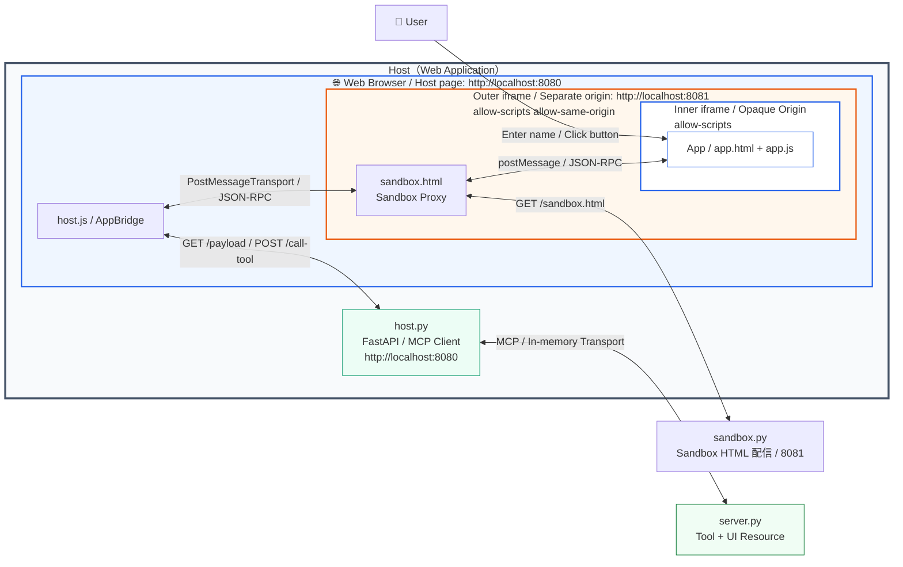

### 06-2. シーケンス図

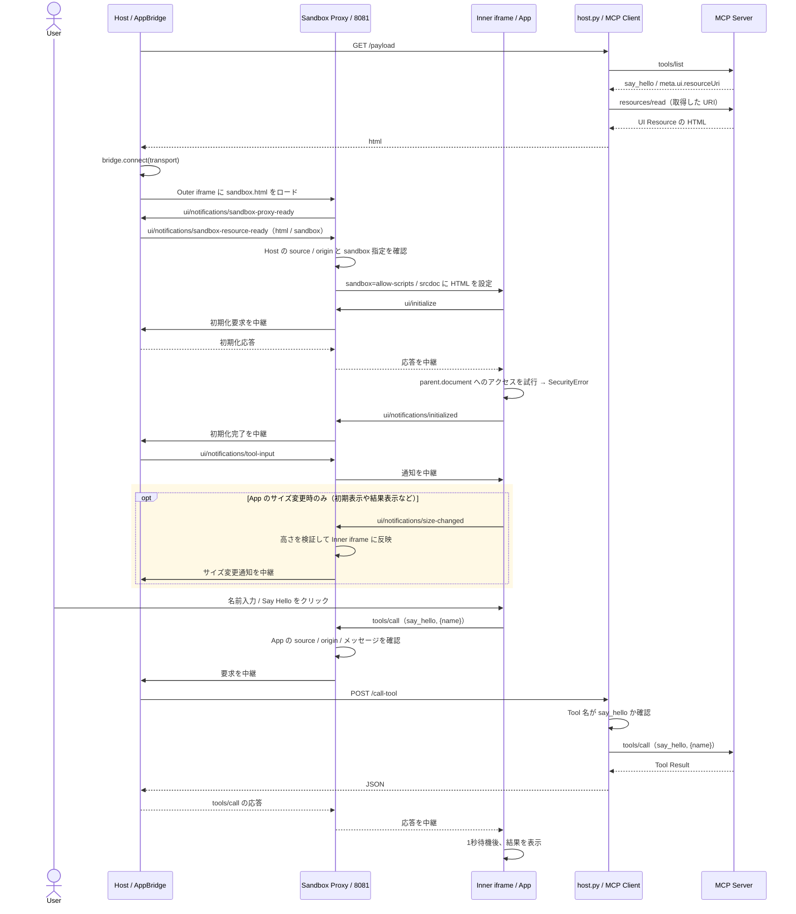

### 06-3. 実装のポイント

| 境界 | 実装で確認する内容 |
| --- | --- |
| Host → Sandbox Proxy | Proxy は `event.source === window.parent` と `event.origin === "http://localhost:8080"` を確認 |
| App → Sandbox Proxy | Proxy は `event.source === inner.contentWindow` と `event.origin === "null"` を確認 |
| App から中継するメッセージ | JSON-RPC 2.0 のみを中継し、App からの `ui/notifications/sandbox-*` は拒否 |
| Inner iframe の権限 | `allow-scripts` のみ。異なる sandbox 指定は拒否 |
| Backend の Tool 呼び出し | 04・05と同様に `say_hello` のみを許可 |

[sandbox.html](06-security/sandbox.html) の Inner iframe は `allow-same-origin` を持たないため、Opaque Origin として動作し、メッセージの `origin` は文字列 `"null"` になります。`null` だけで送信元を特定せず、Window の一致も確認しています。Proxy からこの iframe への送信には `targetOrigin: "*"` を使い、Host への送信には明示した `HOST_ORIGIN` を使います。

[app.js](06-security/app.js) は、接続後に `window.parent.document` を読み取ろうとします。この親は Host ではなく Sandbox Proxy です。`Parent DOM access blocked: SecurityError` が記録されることで、App と親画面の DOM が分離されていることを確認できます。DOM を直接参照できてもよいという意味ではなく、許可したメッセージ経路を使って Tool 呼び出しを継続できることを確認します。

Outer iframe の `allow-same-origin` は Proxy のオリジンを保持するための指定です。8080の Host と8081の Proxy を同一オリジンにするものではありません。また、[host.js](06-security/host.js) の追加 `message` リスナーにある source / origin 検証は観察用ログの入口です。このリスナーで `return` しても、AppBridge の Transport に対する受信フィルターを設定したことにはなりません。本サンプルは二重 iframe と中継処理を観察する実装であり、包括的なセキュリティ検証を示すものではありません。

この章では `autoResize: true` を指定しています。Proxy は `ui/notifications/size-changed` の高さが正の有限数であることを確認し、Inner iframe の高さへ反映します。

初期表示時の `/payload` は04・05と同様に UI の HTML だけを返します。Tool は App 内のボタンを押したときに実行し、結果は Sandbox Proxy を経由して App に返します。

### 06-4. 実行結果

実行結果は [ブラウザーのコンソールログ](06-security/browser-developer-tools-console.log.txt) と下記の動画をご参照ください。

https://github.com/user-attachments/assets/bd1e06a4-fb75-4354-a4f8-6fc48c089adf

## 参考 URL

- [MCP Extensions — Overview](https://modelcontextprotocol.io/extensions/overview)
- [MCP Apps — Documentation / API](https://apps.extensions.modelcontextprotocol.io/api/)
- [MCP Apps — Specification / SDK](https://github.com/modelcontextprotocol/ext-apps)
- [AppBridge — API Reference](https://apps.extensions.modelcontextprotocol.io/api/classes/app-bridge.AppBridge.html)
- [MCP Apps Specification — Sandbox proxy](https://github.com/modelcontextprotocol/ext-apps/blob/main/specification/2026-01-26/apps.mdx#sandbox-proxy)
- [MCP SDK for Python](https://github.com/modelcontextprotocol/python-sdk)
- [MCP Python SDK v2.3.0 — Protocol versions](https://github.com/modelcontextprotocol/python-sdk/blob/v2.3.0/docs/protocol-versions.md)

公式ドキュメントは更新されます。本文の通信経路と挙動は、冒頭のコミットにあるサンプル実装を対象としています。
